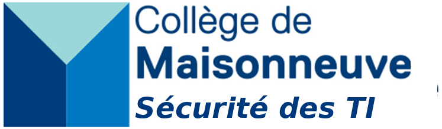

# Session <Session ici>

Bienvenue sur le site du cours Sécurité des TI du Collège de Maisonneuve. Vous trouverez sur ce site toutes les notes de cours, l'ordre du jour des différentes séances et le code des différents projets.

Quelques liens importants:

* [Omnivox/Léa](https://cmaisonneuve-lea.omnivox.ca/)
